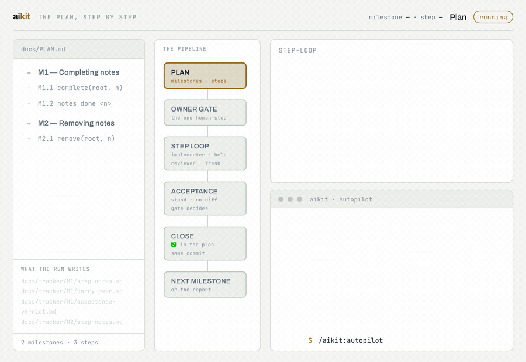

# aikit

A delivery pipeline for [Claude Code](https://claude.com/claude-code) that can
run without someone watching it.

Plan the work into numbered milestones. Take each step through a reviewer that
**cannot edit code**. Take each finished milestone through an acceptance agent
that **never sees the diff**. Nothing passes on the author's own word.

<picture>
  <source media="(prefers-color-scheme: dark)" srcset="docs/steploop-dark.gif">
  
</picture>

A real two-milestone run. The plan is on the left and its steps tick off one at
a time; the middle is the pipeline itself, every block on screen throughout,
with the live one lit; the right is whatever is happening inside that block.
Round one of `M1.2` comes back blocking, on purpose — the loop is the product,
and a clean straight-through run would show you the opposite of what this does.
[**Watch the pipeline interactively →**](https://claude.ai/code/artifact/00501ab2-7b5e-470b-b5bf-8a71054e279c)

## Why it exists

A test suite checks what the author foresaw. That is a real limit, not a
staffing problem — which is why the findings that matter keep arriving through
the owner's own eyes while the suite is green. Adding more tests does not fix
it. What is missing is a **layer of judgement**: someone who uses the thing and
says whether a person could.

aikit adds two such layers, and both work the same way — by taking something
away rather than by asking nicely:

| | how it is independent |
|---|---|
| `reviewer` | has no `Write` or `Edit` tool at all — it *cannot* patch what it reviews |
| `acceptance` | its brief contains no file names — looking for the code destroys the only check it exists for |
| the gate (`bin/verdict`) | a program, not a paragraph: an incomplete report exits non-zero exactly like a breakage |

A rule enforced by an instruction holds until the first long run. A rule
enforced by a missing tool holds always.

## Install

```
/plugin marketplace add earlzdev/aikit
/plugin install aikit
```

**Then restart Claude Code.** Skills and agent types are read at startup, so
until you do, `/aikit:init` is not there and neither are the agents — which
looks exactly like a failed install and is not one. The same applies to
upgrades: `/plugin marketplace update aikit && /plugin install aikit` puts the
new version in the cache, and the session you are sitting in keeps running the
old one until it restarts.

To upgrade later, and to check which version you are actually on:

```
/plugin marketplace update aikit
/plugin install aikit
ls -d ~/.claude/plugins/cache/aikit/*/*/ | sort -V | tail -1
```

That last line is the path the skills themselves resolve to. Several versions
stay cached side by side and the glob takes the highest it finds, so it is
worth looking rather than assuming.

Then, in a project:

```
/aikit:init
```

It reads the repo, asks only what it cannot infer, writes one `aikit.yml`, and
**proves the pieces run** rather than declaring success.

## Use

```
/aikit:plan  <what to build>     # milestones, each with its own "done when"
/aikit:autopilot                 # run the pipeline until done or genuinely blocked
```

or a single piece on its own — each skill is invocable by name:

```
/aikit:step-loop <task>          # build it, then loop an independent reviewer
/aikit:acceptance-loop <n>       # walk a finished milestone by hand
```

## One config, not copied templates

Everything project-specific lives in one `aikit.yml` at the repo root, read at
**runtime**:

```yaml
zones:
  - key: backend
    paths: ["src/**"]
    verify: "pytest -q"
verify_all: "ruff check . && pytest -q"
review:
  rounds: { develop: 3, fix: 2 }
```

This is the design decision the whole plugin turns on. aikit's predecessor
substituted values into copied template files at scaffold time — which works
exactly once. Two projects built that way ended up five versions behind with no
upgrade path, because a rendered copy can only ever be re-rendered over the
owner's own edits. Reading the values at runtime means upgrading aikit changes
nothing in the project.

Full reference: [`docs/config.md`](docs/config.md). Worked examples:
[`docs/examples/`](docs/examples/).

## Three agents, three lifetimes

Autopilot dispatches; it does not build. Every line of code in a run is written
by an **implementer** and judged by a **reviewer** that has no editing tool,
and each agent lives exactly as long as its authorship does:

| | lifetime | why |
|---|---|---|
| `implementer` | fresh per step, **held** across that step's review rounds | the agent that wrote the code knows why it chose what it chose; a new one re-deriving that from a diff is worse and costs more |
| `reviewer` | **fresh every round** | a reviewer that blessed something in round one is anchored to bless it again. Its cold start is identical on every spawn and therefore cached — carrying its transcript over would cost more, not less |
| `acceptance` | fresh every round | same reason, plus it must never learn how the thing was built |

No agent outlives its unit. When a step or an acceptance round closes, the loop
calls `TaskStop` on every agent it spawned for it, so nothing still running can
commit into the next step's diff or drop a capture into the next round's
evidence. What it cannot do is take a *finished* agent off the list — no tool
the orchestrator holds does that, and `TaskStop` refuses a completed subagent —
but a finished agent costs nothing while it is still listed.

That split is also what keeps a long run affordable. A conversation re-sends
everything it holds on every turn, so one agent building twenty steps ends up
paying for the whole plan on the last one. Twenty short-lived implementers do
the same work with the cost bounded by a step; autopilot itself sees only
summaries, reviewer reports and verdict lines — and never a diff or a file's
contents.

## What ships

```
skills/     init · plan · step-loop · acceptance-loop · autopilot
agents/     implementer · reviewer · acceptance
bin/        verdict (the gate) · drive (browser hands)
docs/       pipeline*.html · steploop*.html — the two animations, regenerable
```

`bin/verdict` is dependency-free Python and unit-tested — it is the piece that
decides whether a milestone may merge, so it is the piece that has to be right:

```
python3 -m unittest discover -s tests
```

## What your project supplies

Two commands, and only if you want the acceptance phase at all. Leave the
`acceptance` block out of `aikit.yml` and the phase does not exist — the right
configuration for anything with no interface to walk.

- **a disposable stand** (`up` / `down`) — never production, torn down with its
  volumes;
- **a read-only query** — one `SELECT`, under a database role with no write
  privilege. Read-only as a property of the role, not as an instruction: an
  agent that *can* fix the stand to match its expectation eventually will.

Contract and worked example: [`docs/harness.md`](docs/harness.md).

Hands are optional — `bin/drive` attaches to a Chromium over CDP and gives the
agent an accessibility tree plus a screenshot after each action, enforcing the
action and time budgets itself. Point `acceptance.hands` at your own driver when
the browser is only reachable from inside a container — or at MCP tools, for a
stack that is not a browser at all. The agent holds every tool the project has;
`hands` and `truth` only tell it which ones reach this product.

## Licence

MIT.
